# PaperNotes

**给 DeepSeek Harness 的论文阅读工作台。** 把一篇论文拆成可拖拽的思维节点，逐块提问、记笔记，最后收束成一份自己的读后整理；也能把几篇论文摊在同一张台面上对比。

> 插件包名是 `dsh-paper-desk`（保持不变，避免重装与数据迁移），显示名是 **PaperNotes**。

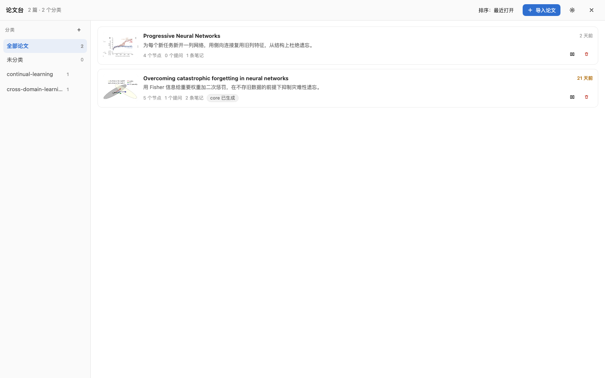

---

## 为什么做这个

读论文的痛点通常不是"读不完"，而是**读完就忘、忘了不知道从哪捡起**。PaperNotes 的思路是：

1. 导入时先把论文**拆块**（问题动机 / 核心原理 + 原理图 / 关键公式 / 结果图），让结构先浮出来；
2. 读的时候**对着某一块提问**，回答只带这一块的上下文，不会泛泛而谈；
3. 想不通的、想通了的，都**记在块上**；
4. 最后让模型把这些提问与笔记收束成一份 **core 核** —— 下次复习先看它；
5. 多篇论文可以摊开**对比**，讨论记录按论文组合存盘。

---

## 功能

### 导入与拆块

- 浏览器端用 **pdf.js** 抽全文并**按图注裁图**：Figure / Fig. / Table / 图 / 表 都认，裁图按栏切、按正文行定边界、再按墨迹收紧，双栏与跨栏整幅图都能裁全；
- 宿主再让模型整理成节点：
  - **计算机 / 算法类** → 问题动机 · 核心原理（+原理图）· 关键公式 · 结果（+结果图）
  - **化学 / 生物 / 材料 / 医学类** → 问题动机 · 实验原理 · **操作步骤** · **现象** · **结论**（保留试剂、温度、时间等原文数值）
- 裁得不对有两条兜底：**上传图片**（本地文件）、**框选配图**（在原文上拖一个矩形，按 PDF 坐标以 3x 重渲染）。
- 每张图都标出**它在论文哪一节**：图注里解析出 `Figure 2`，章节从正文标题里按页推出，节点上显示成 `Figure 2 · §4.5 Results`；
  核心公式同理，卡片上带 `§3.2 Method`。图库和大图里也是同一套标签。

| 论文库 | 画布 |
|---|---|
|  | 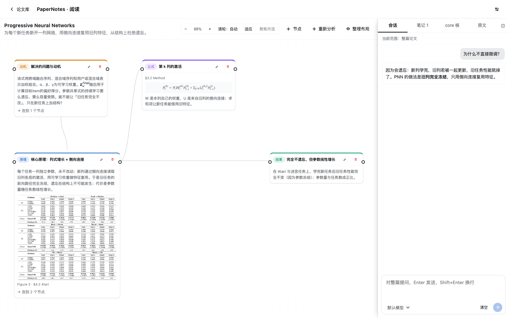 |

裁图不准时可以**框选配图**：在原文上拖一个矩形，这一块按 PDF 坐标以 3x 重渲染后挂到当前节点。

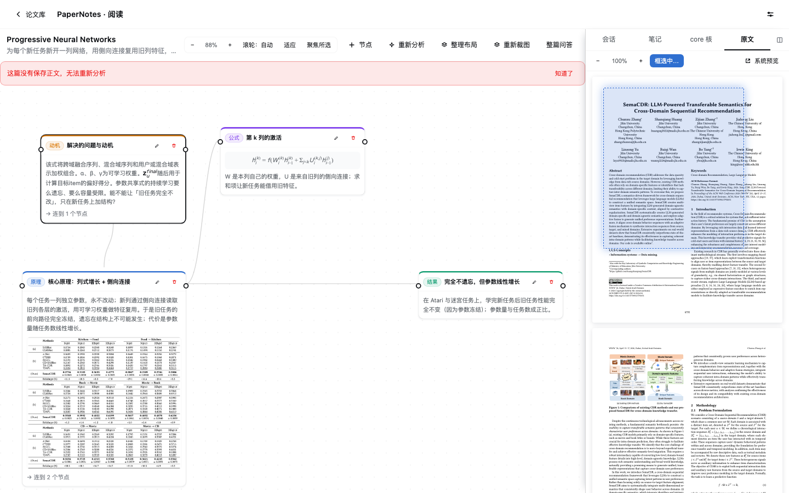

### 画布式工作流

- 按住节点任意位置就能拖（不用先点标题栏选中），从端口拖线连接；
- **八向拉尺寸**（四边 + 四角），只靠光标变化提示，边框上不画任何方块；从左边/上边拉时对边钉住；双击任意边角恢复自适应；
- 画布空白处拖动平移、两指滑动平移、捏合缩放、`⌘/Ctrl + 滚轮` 缩放、`Shift + 滚轮` 水平平移；工具栏可切换「滚轮 = 自动 / 缩放 / 平移」；

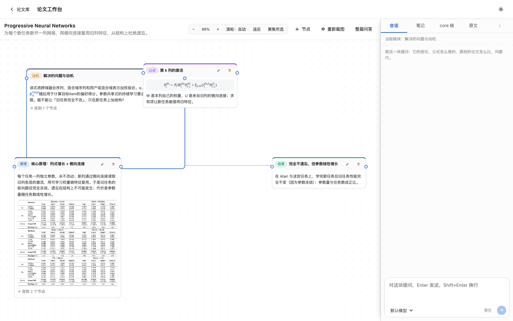
- 首次打开自动适应窗口，缩放与位置随论文存盘。

### 会话（流式 + thinking）

- 点节点 → 右侧「会话」切到该块，提问只带这一块的上下文；「整篇」切回全篇；
- 回答**逐字流式**出现，思考过程收在可折叠的 **thinking** 块里；可「停止」（SSE + AbortController）；
- 每条消息右下角可复制；
- 中文/日文输入法里按 Enter 是确认候选词，不会被误发（组合中、`isComposing`、`keyCode 229`、组合结束后 120ms 内都不发）。

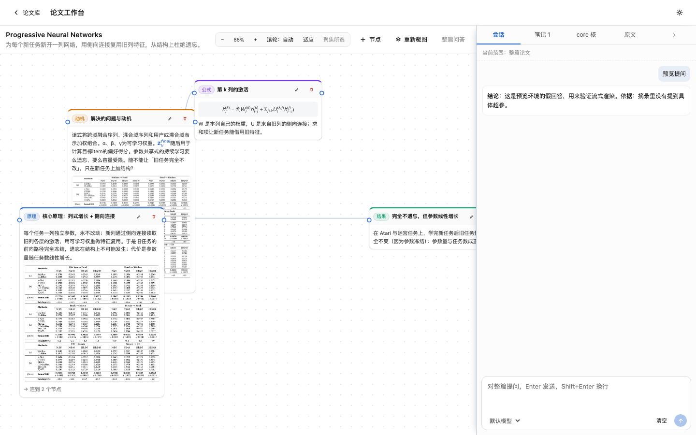

### 笔记与 core 核

- 自己记（理解 / 不理解都行），或点「AI 浓缩」把这一块的提问压成一条复习笔记；
- core 核：一句话总结 / 解决什么问题 / 核心思路 / 关键公式 / 主要结果 / 我没想通的地方 / 下次复习先看这三件事；
- 笔记、节点正文、core 统一走 markdown + KaTeX，行内 `$...$` 也会渲染。

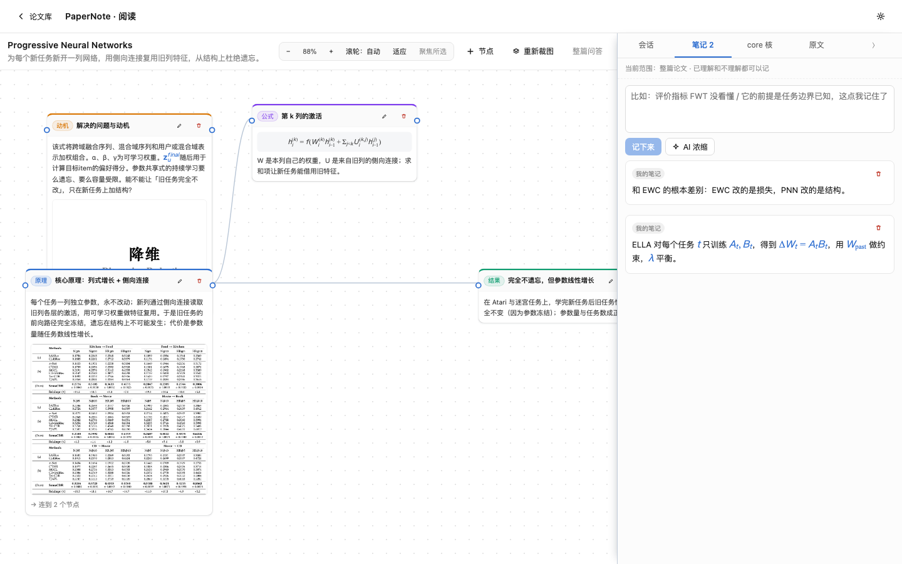

### 对比台

- 勾选 ≥2 篇 → 「对比」→ 各篇原理图变成可拖动卡片；
- 卡片可**八向拉伸**、点哪张哪张置顶、展开「核心思想与公式」时自动长高并把视图平移回来；
- 右侧会话与论文视图同款（模型选择 / 流式 + thinking / 停止 / 清空 / 复制）；
- **范围可选**：全部论文一起对比，或只问某一篇；
- 讨论记录按论文组合存盘（`compare-chats.json`，键是排序后的论文 id）。

| 对比台 | 展开详情 |
|---|---|
| 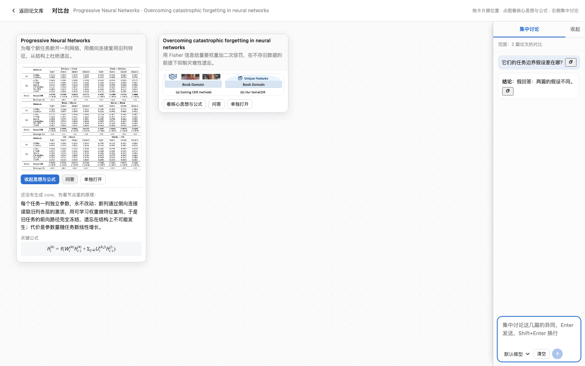 | 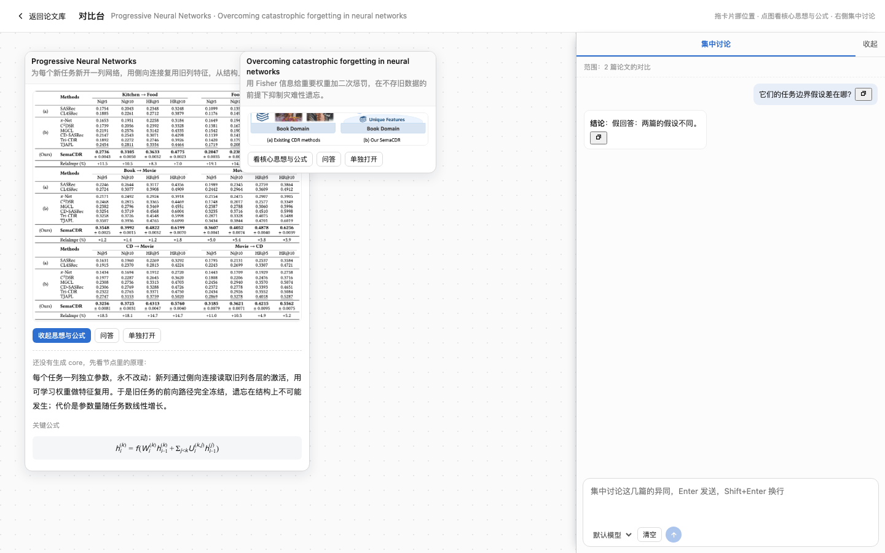 |

### 论文管理与整理

- 自建分类目录（`continual-learning`、`cross-domain-learning`……），右键论文可**移动 / 复制**到分类；
- 「最近一次打开」，超过 14 天标黄；可按最近打开 / 最久没看排序；
- 数据目录可选（设置 → 数据目录），能放进同步盘。

### 裁图质量（用真论文调过）

| 修好前 | 修好后 |
|---|---|
| WeaveRec Figure 5 只裁到 85px 横条 | 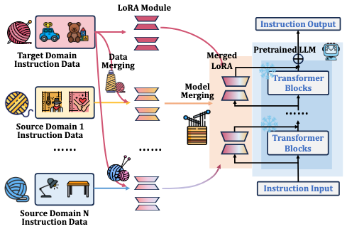 |
| LLM-RecG Figure 1 被从中间竖切 | 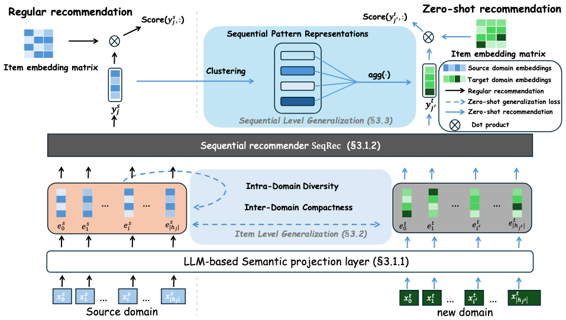 |
| SemaCDR Table 1 混进图注与正文 | 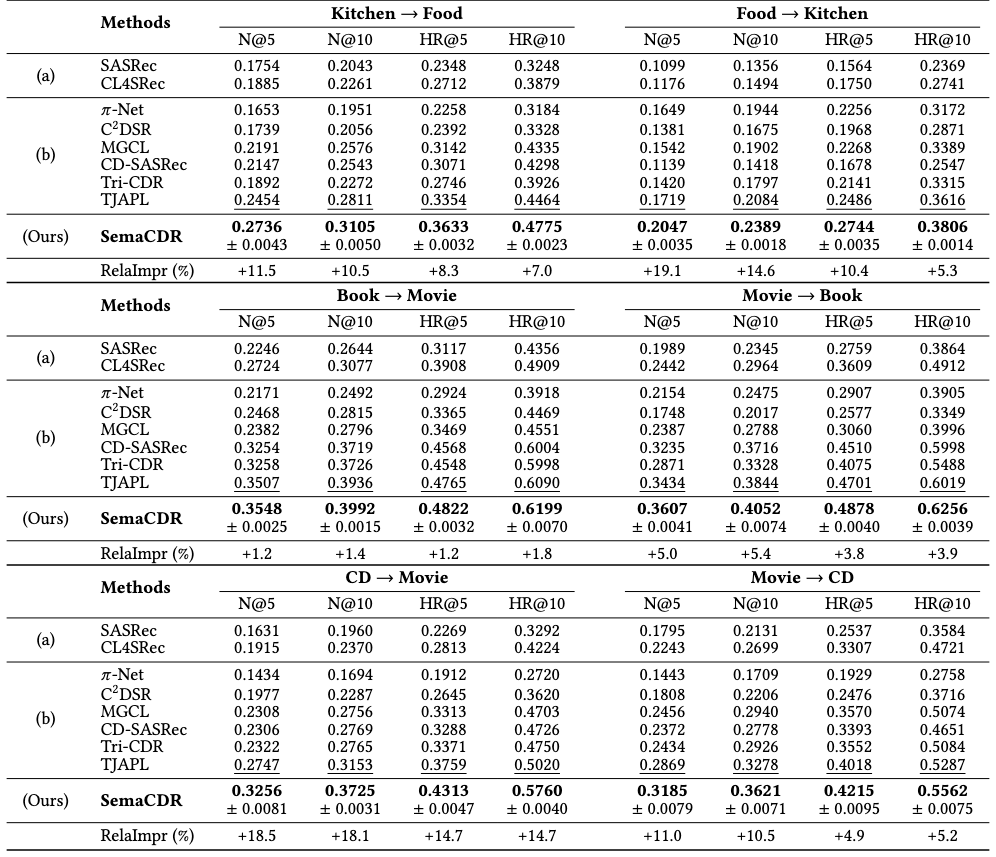 |

---

## 安装

### 前置

DeepSeek Harness Desktop（下称 DSH Desktop）已经在跑，并且**配置好至少一个模型**（导入时的拆块、会话、core 都靠它）。

### 方式一：插件管理器（推荐）

1. 打开 DSH Desktop → 插件管理器；
2. 选「从本地目录 / 包安装」，指向本仓库目录（或在装了 pnpm 的环境里执行 `pnpm pack` 后指向 `.tgz`）；
3. 装好后**重启 DSH Desktop**（宿主半侧的路由要随进程启动）；
4. 左侧边栏出现 **PaperNotes** 图标，点进去就是论文库。

### 方式二：命令行

```bash
git clone git@github.com:pingf0/PaperNotes.git
cd PaperNotes
pnpm install      # 只装 esbuild / pdfjs-dist / katex 这些构建期依赖
pnpm build        # 产出 client.js + dist/pdfjs.mjs + dist/pdf.worker.mjs
```

然后同上，用插件管理器指向这个目录。

> 仓库里已经带了构建产物（`client.js`、`dist/`），所以**直接安装仓库目录也能用**，`pnpm build` 只在改代码后需要。

### macOS 与 Windows

| | macOS | Windows |
|---|---|---|
| 数据目录 | `$DSH_HOME/paper-desk/data`（通常是 `~/Library/Application Support/dsh-desktop/harness/paper-desk/data`） | 同左，`$DSH_HOME` 通常是 `%APPDATA%\dsh-desktop\harness` |
| 「系统预览」打开 PDF | `open <file>` | `cmd /c start "" <file>`（对带空格路径更稳） |
| 字体 | 系统字体 | 已加 `Segoe UI` / `Microsoft YaHei` 兜底 |
| 其余 | 纯浏览器端渲染，两端一致 | 同左 |

如果你的环境没设 `DSH_HOME`，插件会退到 `~/.dsh/paper-desk/data`（两端都一样）。

---

## 数据存在哪

```
$DSH_HOME/paper-desk/config.json       数据目录指针（"数据目录不能存在数据目录里"）
<数据目录>/index.json                   分类 + 论文摘要（列表页只读它）
<数据目录>/papers/<paperId>/paper.json  节点、连线、笔记、会话、core
<数据目录>/papers/<paperId>/fig-<n>.png 裁出来的图（含手动上传 / 框选的）
<数据目录>/papers/<paperId>/source.pdf  原始 PDF（≤24MB 时保存）
<数据目录>/compare-chats.json           对比台讨论记录
```

换数据目录等于换一个论文库，旧内容不会自动搬过去。

---

## 结构

```
index.js                 宿主半侧：把 prefix 路由挂到 DSH WebServer
client.js                浏览器半侧构建产物（esbuild 打出，不要手改）
src/host/store.js        数据目录解析 + 原子读写
src/host/import.js       PDF 干文本 → 节点（含学科模板与启发式兜底）
src/host/chat.js         逐块问答 / 笔记浓缩 / core / 对比（流式与非流式）
src/host/llm.js          ctx.llm 薄封装（含 reasoning 与 finish 原因）
src/host/server.js       全部 HTTP 路由
src/client/index.jsx     模块加载器入口（main + sidebar.panellist）
src/client/app.jsx       论文库
src/client/canvas.jsx    画布（拖拽 / 缩放 / 连线 / 改尺寸 / 图注板块）
src/client/drawer.jsx    右侧栏（会话 / 笔记 / core / 原文）
src/client/compare.jsx   对比台
src/client/pdf.js        pdf.js 抽文与裁图算法
src/client/pdf-viewer.jsx 原文连续滚动 + 框选配图
src/client/ui.jsx        图标 / 弹窗 / 下拉 / Markdown / IME 守卫
dist/pdfjs.mjs           pdf.js 本体（宿主静态伺服，首次导入时才动态加载）
dist/pdf.worker.mjs      pdf.js worker
scripts/build.mjs        构建：client.js + 两个 pdf.js 资源 + KaTeX 字体内联
tests/                   宿主路由自检 / bundle 自检 / PDF 抽取真机验证 / Playwright 预览台
```

---

## 开发与测试

```bash
pnpm install          # esbuild / pdfjs-dist / katex / react（测试用）
pnpm build            # 改完 src/client 后必须重建 client.js
pnpm test             # 宿主路由 31 项 + bundle 10 项 + 公式 6 项 + 空回复 11 项
pnpm test:ui          # Playwright 全流程（需 playwright + chromium，缺了会 SKIP）
```

浏览器测试的环境变量（都可不设，缺东西时自动跳过）：

| 变量 | 作用 |
|---|---|
| `PN_PLAYWRIGHT` | playwright 入口（默认从 node_modules resolve） |
| `PN_CHROMIUM` | Chromium 可执行文件（默认让 playwright 自己找） |
| `PN_THEME_DIR` | DSH 的 ui-theme 样式目录（预览台用它还原真实主题变量） |
| `PN_SAMPLE_PDF` | 一份真实 PDF，用于验「原文 / 框选配图」两步 |

## 已知限制

- 裁图假设"图在上、图注在下"（表格是"图注在上、表在下"，已单独处理）；扫描版 PDF 抽不到文字与图注，只能用框选配图；
- 不写 `$` 的 LaTeX 只对常见命令 / 带花括号 / 带上下标的形式生效；
- 会话与笔记存在插件自己的数据目录，不进 DSH 的会话日志；
- 超过 24MB 的 PDF 不保存原文（仍可导入与裁图）；
- 界面文案目前是中文。

## 致谢

pdf.js、KaTeX、esbuild。

## License

MIT
